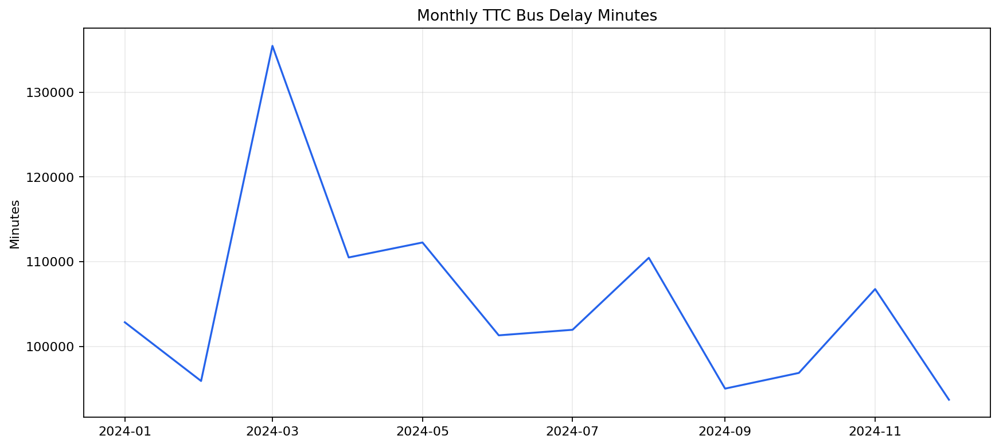
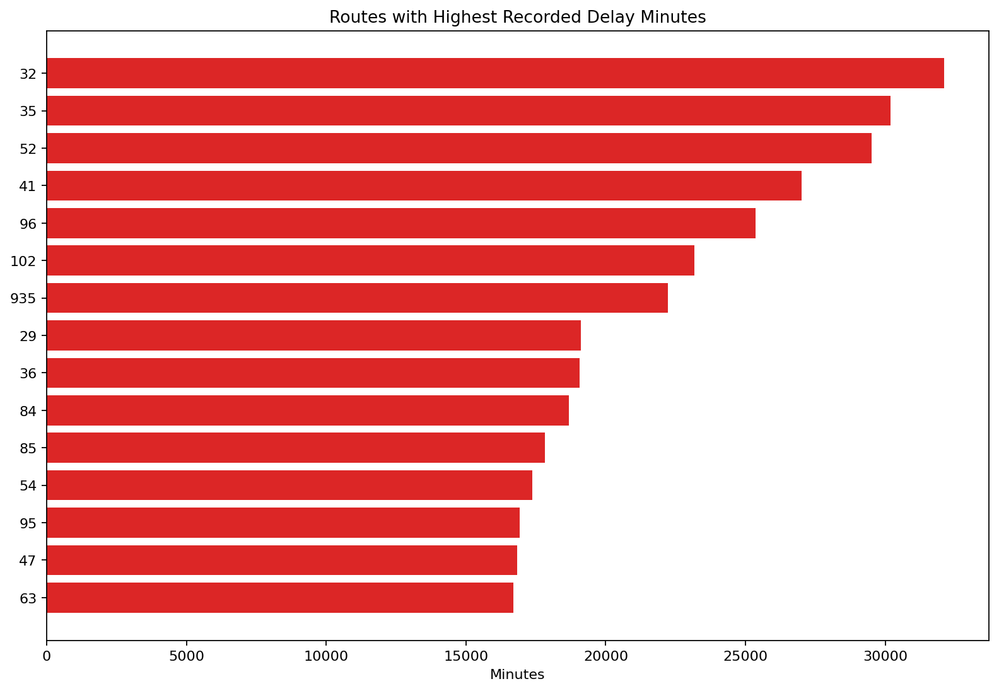
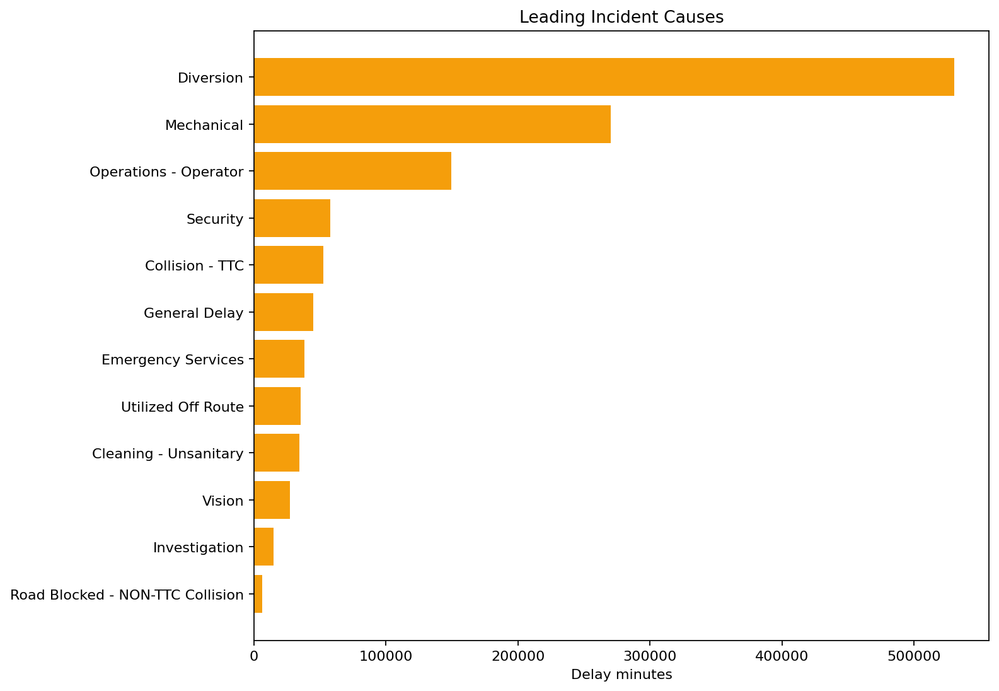

# TTC Bus Delay Reliability

**Author:** Mohammed Adeen Shaik  
**Review date:** 11 October 2026

## Research question

Which routes and incident categories contribute most recorded delay minutes?

## Data and provenance

Toronto Open Data TTC bus delay workbook for 2024.

Source materials are linked from the repository README. Input fingerprints are recorded in [the evidence manifest](evidence.json) so a reader can identify the exact committed artifacts used in this review.

## Method and analytical rationale

Source sheets are normalized into an event table. Invalid dates and negative delay or gap minutes are excluded. Scorecards distinguish frequency, severity and total recorded delay.

## Findings and interpretation

Fresh execution on 11 October 2026 using the **2024 workbook only**. After the pipeline eligibility filters, **59,021 events** remain, totaling **1,263,332 recorded vehicle-delay minutes**. The leading incident category by minutes is **Diversion**. The values measure recorded incidents, not passenger minutes or delay per scheduled trip.

| Measure | Value |
|---|---:|
| events | 59021 |
| recorded delay minutes | 1263332.0000 |
| source window | 2024 |

## Limitations

Recorded vehicle delay minutes are not passenger time lost. Without service frequency or ridership denominators, high totals do not prove that a route is intrinsically less reliable.

## Reproduction

Use the setup commands and input contract in the [repository README](https://github.com/Adeen1607/toronto-transit-reliability#readme). Open the [notebook catalogue](notebooks.html) for annotated code and saved outputs. Keep raw records and model binaries local; public reports contain aggregate results or source-embedded figures.

## Final visual results

*Figure from key_visuals.ipynb, original code cell 3.*

*Figure from key_visuals.ipynb, original code cell 4.*

*Figure from key_visuals.ipynb, original code cell 5.*

